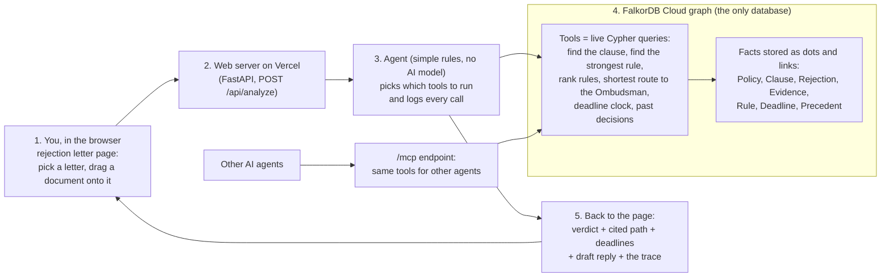
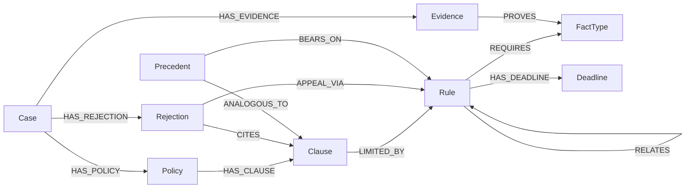

# ClaimPath: the claim rejection case file

**ClaimPath helps you find out if your health insurance rejection can be fought.**

When an insurer rejects a claim, the letter only gives their reason, and most people give up. But the rules that protect you are spread across your policy, the insurance regulator's rules and the law, and almost nobody reads them.

ClaimPath puts them together. You drop in your rejection letter and it shows, step by step, which part of your policy they used, which rule might be on your side, and how long you have to complain. Every step links to its source. Add the one document that's missing, such as proof you had cover earlier, and the answer changes from "rejected" to "worth fighting". It works for India and the USA.

It stores all of this as connected facts in FalkorDB, so it can show how a rejection links to the rule that may beat it. The demo cases are made up, the rules and past decisions are real and public, and it isn't legal advice.

**Live demo:** https://claimpath-srini5.vercel.app &nbsp;|&nbsp; **Demo video:** https://www.youtube.com/watch?v=5GkhxY66JyA &nbsp;|&nbsp; **Repo:** public (this one) &nbsp;|&nbsp; **MCP endpoint** (lets other AI agents use the same tools): `POST https://claimpath-srini5.vercel.app/mcp`


## Hackathon track

**Track 1: Agents That Act on Connected Data (FalkorDB Graph Hacks).** The agent works only by running live queries on a FalkorDB graph, and every query is logged and shown. The same tools are open to other agents over MCP. Every rule it cites links to its official source.

## The problem

Most people stop after a rejection letter. In the US, fewer than 1% of denied claims on the ACA marketplace were appealed in 2023 ([KFF](https://www.kff.org/private-insurance/claims-denials-and-appeals-in-aca-marketplace-plans-in-2023/)). India's Insurance Ombudsman got 31,490 health complaints in FY2023-24, about 95% of the ones it could handle about rejected claims ([annual report](https://cioins.co.in/annualreports/AnnualReport2023-2024.pdf)). The full evidence, and how well each figure was checked, is in [docs/problem-evidence.md](docs/problem-evidence.md).

## How it works at a glance



You drop in a letter. The server asks the agent to check it. The agent looks facts up in the graph: the clause cited, the rules that limit it, your evidence, the deadlines, and what similar past cases decided. You get a verdict, the chain of facts behind it, the deadlines and a draft reply.

## How FalkorDB is used

FalkorDB is a graph database: it stores facts as dots and the links between them. Here it is the only place data lives. The answer to "can I fight this?" is a path between connected facts, so every agent tool is a Cypher query (Cypher is FalkorDB's query language). The queries follow links several steps deep, find the shortest route to the final free complaint forum, rank rules by how connected they are (PageRank), and find past decisions two links away. The "what if I had this document" switch is a setting on one request. It is never saved.

## Graph data model



Nodes: `Case`, `Policy`, `Clause`, `Rejection`, `Evidence`, `Rule`, `FactType`, `Deadline`, `Precedent` (plus a `Meta` bookkeeping node). Relationships: `HAS_POLICY`, `HAS_CLAUSE`, `HAS_REJECTION`, `CITES`, `HAS_EVIDENCE`, `LIMITED_BY`, `REQUIRES`, `PROVES`, `RELATES`, `APPEAL_VIA`, `HAS_DEADLINE`, `ANALOGOUS_TO`, `BEARS_ON`.

## Key Cypher queries

The app shows every query it runs under "show my working". Three key ones are here; all 10 are in [docs/queries.md](docs/queries.md).

**Which rule applies, and what evidence is missing** (`strongest_rule_path`):

```cypher
MATCH (cl:Clause {id:$clid})
OPTIONAL MATCH (cl)-[lb:LIMITED_BY]->(r:Rule)
OPTIONAL MATCH (r)-[rq:REQUIRES]->(ft:FactType)
OPTIONAL MATCH (ev:Evidence {case_id:$cid})-[pv:PROVES]->(ft)
RETURN r.id, r.name, r.citation, ..., ft.key, rq.role, ev.id, pv.value
```

**Shortest route to the final free forum** (`escalation_path`):

```cypher
MATCH (j:Rejection {id:$rid}), (t:Rule {terminal:true, jurisdiction:$j})
WITH shortestPath((j)-[:APPEAL_VIA|RELATES*..6]->(t)) AS p
RETURN [n IN nodes(p) | n.id], length(p)
```

**Rank the rules** (`rule_centrality`, PageRank):

```cypher
CALL algo.pageRank('Rule','RELATES') YIELD node, score
WHERE node.jurisdiction = $j RETURN node.id, node.name, score ORDER BY score DESC
```

## Run it

```bash
git clone https://github.com/sivaratrisrinivas/claimpath && cd claimpath
./scripts/run_local.sh   # starts FalkorDB in Docker, loads the data, serves http://localhost:8000
python3 -m venv .venv && .venv/bin/pip install -r requirements-dev.txt && .venv/bin/python -m pytest -q   # tests
```

To use a hosted FalkorDB, set `FALKORDB_HOST`, `FALKORDB_PORT`, `FALKORDB_USERNAME` and `FALKORDB_PASSWORD` (and `FALKORDB_SSL=1` for TLS). The live site uses FalkorDB Cloud. More: [docs/what-it-does.md](docs/what-it-does.md).

## Data

The two demo cases (one India, one US) are made up. The rules are real and each links to its official text. The 118 past decisions are public records ([details](docs/precedents.md), [sources](docs/sources.md)).

## Limitations

- Only two made-up cases and 10 rules. "Likely valid" means none of these rules beats the insurer's reason, not that the insurer is right.
- It is a first check, not legal or medical advice. It does not predict outcomes.
- Some rules were checked less well than others. Each rule says how it was checked.
- Pasted text is matched to a clause by keywords, not by AI. For the US it covers only the federal minimum.
- It never files anything or contacts anyone for you. Full list: [docs/limitations.md](docs/limitations.md).

## AI assistance

Built with AI coding help (Grok Bot). The author is responsible for the code and can explain the graph model, the queries and the design above. The project is new work for this hackathon.

## More

Evidence, all queries, past decisions, accuracy check, design notes and sources: [docs/](docs/README.md).
