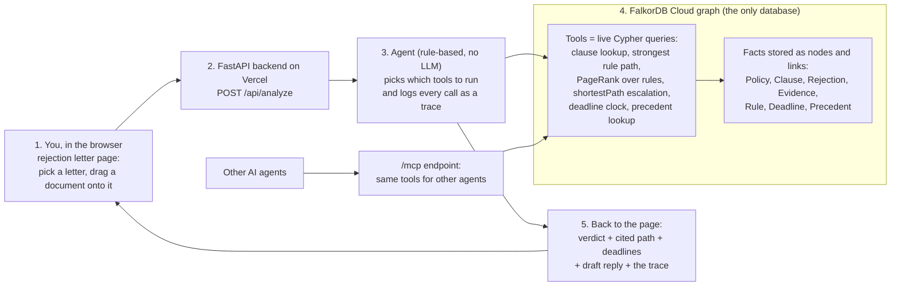
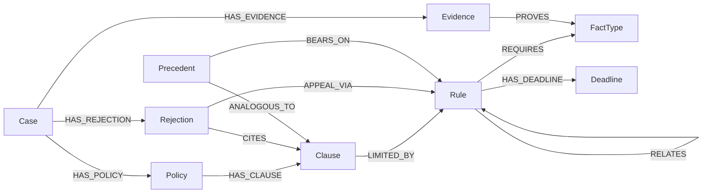

# ClaimPath: the claim rejection case file

**An insurer's rejection letter cites one clause and ends the conversation; ClaimPath shows the whole traceable path (clause, rule, evidence, deadlines) from a FalkorDB graph, and a draft reply, in seconds.**

**Live demo:** https://claimpath-srini5.vercel.app &nbsp;|&nbsp; **Demo video:** https://www.youtube.com/watch?v=5GkhxY66JyA &nbsp;|&nbsp; **MCP endpoint:** `POST https://claimpath-srini5.vercel.app/mcp` &nbsp;|&nbsp; **Repo:** public (this one)


## Hackathon track

**Track 1: Agents That Act on Connected Data (FalkorDB Graph Hacks).** The agent's tools are live Cypher queries over a FalkorDB graph, each call is logged with its query, and the same tools are exposed over `/mcp`. The verdict is computed from graph traversals and carries a source link on every rule it cites.

## The problem

A rejection letter is written to end the conversation, so most people stop. In the US, KFF found fewer than 1% of denied in-network marketplace claims were appealed in 2023 ([KFF](https://www.kff.org/private-insurance/claims-denials-and-appeals-in-aca-marketplace-plans-in-2023/)). India's Insurance Ombudsman received 31,490 health complaints in FY2023-24, about 95% of the entertainable complaints disposed were claim rejections ([CIO annual report](https://cioins.co.in/annualreports/AnnualReport2023-2024.pdf)). Yet the rules protecting the policyholder (for example India's 60-month moratorium) are scattered across the policy, regulator circulars and law, and the letter never mentions them. ClaimPath connects the rejection reason to the clause, the rule and the deadline in one cited chain. Full evidence and statuses: [docs/problem-evidence.md](docs/problem-evidence.md).

## How it works at a glance



In plain words: you drop in a rejection letter, the backend asks an agent to check it, and the agent answers only by querying a graph of facts in FalkorDB (which clause was cited, which rules limit it, what evidence you have, what the deadlines are, what similar past cases decided). What comes back is a verdict with the chain of facts behind it, the deadlines and a draft reply. The same graph tools are also exposed at `/mcp`, so other agents can use them directly.

## How FalkorDB is used

If you take FalkorDB out, nothing is left: it is the only store, every agent tool is a Cypher query, and the verdict is computed from the traversal results. It uses multi-hop traversal (clause -> rule -> required fact <- your evidence), `shortestPath` for the escalation route, `algo.pageRank` over rules, and a 2-hop precedent lookup. The what-if is a query parameter (`assume=[...]`), never a write, so visitors do not affect each other.

## Graph data model



Node labels: `Case`, `Policy`, `Clause`, `Rejection`, `Evidence`, `Rule`, `FactType`, `Deadline`, `Precedent`, plus a `Meta` node holding the seed revision.

Relationship types: `HAS_POLICY`, `HAS_CLAUSE`, `HAS_REJECTION`, `CITES`, `HAS_EVIDENCE`, `LIMITED_BY`, `REQUIRES`, `PROVES`, `RELATES`, `APPEAL_VIA`, `HAS_DEADLINE`, `ANALOGOUS_TO`, `BEARS_ON`.

## Key Cypher queries

The agent runs all of these live and shows each query, parameters, row count and timing under "show my working". The other six, and the tool table, are in [docs/queries.md](docs/queries.md).

**Multi-hop rule path** (`strongest_rule_path`):

```cypher
MATCH (cl:Clause {id:$clid})
OPTIONAL MATCH (cl)-[lb:LIMITED_BY]->(r:Rule)
OPTIONAL MATCH (r)-[rq:REQUIRES]->(ft:FactType)
OPTIONAL MATCH (ev:Evidence {case_id:$cid})-[pv:PROVES]->(ft)
RETURN r.id, r.name, r.citation, ..., ft.key, rq.role, ev.id, pv.value
```

**Shortest route to the final free forum** (`escalation_path`):

```cypher
MATCH (j:Rejection {id:$rid}), (t:Rule {terminal:true, jurisdiction:$j})
WITH shortestPath((j)-[:APPEAL_VIA|RELATES*..6]->(t)) AS p
RETURN [n IN nodes(p) | n.id], length(p)
```

**PageRank over rules** (`rule_centrality`):

```cypher
CALL algo.pageRank('Rule','RELATES') YIELD node, score
WHERE node.jurisdiction = $j RETURN node.id, node.name, score ORDER BY score DESC
```

**Precedent lookup** (`precedent_lookup`, 2-hop through the shared rule):

```cypher
MATCH (:Clause {id:$clid})-[:LIMITED_BY]->(r:Rule)<-[:BEARS_ON]-(p:Precedent)-[:ANALOGOUS_TO]->(c2:Clause)
WHERE c2.id <> $clid RETURN p.id, p.year, p.outcome_class
```

## Run locally

```bash
git clone https://github.com/sivaratrisrinivas/claimpath && cd claimpath
./scripts/run_local.sh   # starts falkordb/falkordb in Docker, seeds the graph, serves http://localhost:8000
python3 -m venv .venv && .venv/bin/pip install -r requirements-dev.txt && .venv/bin/python -m pytest -q   # tests, no Docker needed
```

Hosted: set `FALKORDB_HOST`, `FALKORDB_PORT`, `FALKORDB_USERNAME`, `FALKORDB_PASSWORD` (and `FALKORDB_SSL=1` for TLS). The deployed instance is FalkorDB Cloud. More detail: [docs/what-it-does.md](docs/what-it-does.md).

## Data

The two sample cases (one India, one US) are synthetic; the rules are real with a source URL on each; the 118 past decisions are public records ([docs/precedents.md](docs/precedents.md), [sources](docs/sources.md)).

## Honest limitations

- Two synthetic cases and a small graph of 10 rules: "likely valid" means no rule in the graph defeats the clause, not that the insurer is right.
- A triage aid, not legal or medical advice and not a prediction; the real past decisions are an illustrative sample, not win rates.
- Rule verification varies (the 36-month PED cap is secondary-sourced; the FY2022-23 Ombudsman figures are unverified at the primary source).
- Pasted text is matched to a clause by keywords, not a language model; no OCR or real-claim tracking; US plan type is only the federal floor.
- It never files or contacts anyone. Full list: [docs/limitations.md](docs/limitations.md).

## AI assistance disclosure

Built with AI coding assistance (Grok Bot). The author is responsible for the code and can explain the graph model, queries and architecture above. The project is new work for this hackathon; it reuses only generic infrastructure patterns (FastAPI, a single reused DB connection, lock-graph seeding).

## More

Everything else (evidence tables, all 10 queries, precedents, accuracy check, design intent, sources): [docs/ index](docs/README.md).
