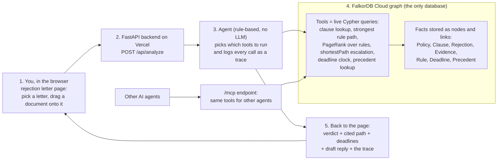
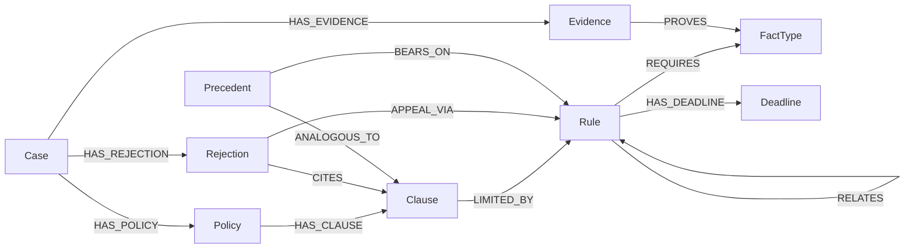

# ClaimPath: the claim rejection case file

**ClaimPath helps you find out if your health insurance rejection can be fought.**

When an insurer rejects a claim, the letter only gives their reason, and most people give up. But the rules that protect you are spread across your policy, the insurance regulator's rules and the law, and almost nobody reads them.

ClaimPath puts them together. You drop in your rejection letter and it shows, step by step, which part of your policy they used, which rule might be on your side, and how long you have to complain. Every step links to its source. Add the one document that's missing, such as proof you had cover earlier, and the answer changes from "rejected" to "worth fighting". It works for India and the USA.

It stores all of this as connected facts in FalkorDB, so it can show how a rejection links to the rule that may beat it. The demo cases are made up, the rules and past decisions are real and public, and it isn't legal advice.

**Live demo:** https://claimpath-srini5.vercel.app &nbsp;|&nbsp; **Demo video:** https://www.youtube.com/watch?v=5GkhxY66JyA &nbsp;|&nbsp; **MCP endpoint:** `POST https://claimpath-srini5.vercel.app/mcp` &nbsp;|&nbsp; **Repo:** public (this one)


## Hackathon track

**Track 1: Agents That Act on Connected Data (FalkorDB Graph Hacks).** The agent's tools are live Cypher queries over a FalkorDB graph, each call is logged with its query, and the same tools are exposed over `/mcp` for other agents. The verdict comes from following links in the graph and carries a source link on every rule it cites.

## The problem

Most people stop after a rejection letter. In the US, KFF found that fewer than 1% of denied claims on the ACA marketplace were appealed in 2023 ([KFF](https://www.kff.org/private-insurance/claims-denials-and-appeals-in-aca-marketplace-plans-in-2023/)). India's Insurance Ombudsman received 31,490 health complaints in FY2023-24, and about 95% of the complaints it could handle were about rejected claims ([CIO annual report](https://cioins.co.in/annualreports/AnnualReport2023-2024.pdf)). Yet the rules that protect the policyholder (for example India's rule that after 60 months of cover a claim can't be contested for non-disclosure) are scattered across the policy, regulator circulars and the law, and the letter never mentions them. ClaimPath links the rejection reason to the policy clause, the rule and the deadline in one chain, with a source for each step. Full evidence and statuses: [docs/problem-evidence.md](docs/problem-evidence.md).

## How it works at a glance



In plain words: you drop in a rejection letter, the server asks an agent to check it, and the agent answers only by looking things up in a graph of facts in FalkorDB (which clause was cited, which rules limit it, what evidence you have, what the deadlines are, what similar past cases decided). What comes back is a verdict with the chain of facts behind it, the deadlines and a draft reply. The same graph tools are also exposed at `/mcp`, so other agents can use them directly.

## How FalkorDB is used

Take FalkorDB out and nothing is left: it is the only place data lives, every agent tool is a Cypher query, and the verdict comes from the results. The answer is the path between connected facts, so it follows links several steps deep (clause -> rule -> required fact <- your evidence), finds the shortest route to the final free complaint forum (`shortestPath`), ranks rules by how connected they are (`algo.pageRank`), and finds past decisions two links away. The what-if is just a query setting (`assume=[...]`), never saved, so visitors do not affect each other.

## Graph data model



Node labels: `Case`, `Policy`, `Clause`, `Rejection`, `Evidence`, `Rule`, `FactType`, `Deadline`, `Precedent`, plus a `Meta` node holding the seed revision.

Relationship types: `HAS_POLICY`, `HAS_CLAUSE`, `HAS_REJECTION`, `CITES`, `HAS_EVIDENCE`, `LIMITED_BY`, `REQUIRES`, `PROVES`, `RELATES`, `APPEAL_VIA`, `HAS_DEADLINE`, `ANALOGOUS_TO`, `BEARS_ON`.

## Key Cypher queries

The agent runs all of these live and shows each query, parameters, row count and timing under "show my working". The other six, and the tool table, are in [docs/queries.md](docs/queries.md).

**Multi-hop rule path** (`strongest_rule_path`):

```cypher
MATCH (cl:Clause {id:$clid})
OPTIONAL MATCH (cl)-[lb:LIMITED_BY]->(r:Rule)
OPTIONAL MATCH (r)-[rq:REQUIRES]->(ft:FactType)
OPTIONAL MATCH (ev:Evidence {case_id:$cid})-[pv:PROVES]->(ft)
RETURN r.id, r.name, r.citation, ..., ft.key, rq.role, ev.id, pv.value
```

**Shortest route to the final free forum** (`escalation_path`):

```cypher
MATCH (j:Rejection {id:$rid}), (t:Rule {terminal:true, jurisdiction:$j})
WITH shortestPath((j)-[:APPEAL_VIA|RELATES*..6]->(t)) AS p
RETURN [n IN nodes(p) | n.id], length(p)
```

**PageRank over rules** (`rule_centrality`):

```cypher
CALL algo.pageRank('Rule','RELATES') YIELD node, score
WHERE node.jurisdiction = $j RETURN node.id, node.name, score ORDER BY score DESC
```

**Precedent lookup** (`precedent_lookup`, 2-hop through the shared rule):

```cypher
MATCH (:Clause {id:$clid})-[:LIMITED_BY]->(r:Rule)<-[:BEARS_ON]-(p:Precedent)-[:ANALOGOUS_TO]->(c2:Clause)
WHERE c2.id <> $clid RETURN p.id, p.year, p.outcome_class
```

## Run locally

```bash
git clone https://github.com/sivaratrisrinivas/claimpath && cd claimpath
./scripts/run_local.sh   # starts falkordb/falkordb in Docker, seeds the graph, serves http://localhost:8000
python3 -m venv .venv && .venv/bin/pip install -r requirements-dev.txt && .venv/bin/python -m pytest -q   # tests, no Docker needed
```

Hosted: set `FALKORDB_HOST`, `FALKORDB_PORT`, `FALKORDB_USERNAME`, `FALKORDB_PASSWORD` (and `FALKORDB_SSL=1` for TLS). The deployed instance is FalkorDB Cloud. More detail: [docs/what-it-does.md](docs/what-it-does.md).

## Data

The two sample cases (one India, one US) are synthetic; the rules are real with a source URL on each; the 118 past decisions are public records ([docs/precedents.md](docs/precedents.md), [sources](docs/sources.md)).

## Honest limitations

- Only two made-up cases and 10 rules: "likely valid" means none of these rules beats the insurer's clause, not that the insurer is right.
- A first check, not legal or medical advice and not a prediction; the real past decisions are examples, not win rates.
- How well each rule was checked varies (the 36-month pre-existing-disease cap comes from news reports; the FY2022-23 Ombudsman figures weren't checked at the original report).
- Pasted text is matched to a clause by keywords, not by AI; no scanning of documents or tracking of real claims; for the US it covers only the federal minimum rules.
- It never files or contacts anyone for you. Full list: [docs/limitations.md](docs/limitations.md).

## AI assistance disclosure

Built with AI coding assistance (Grok Bot). The author is responsible for the code and can explain the graph model, queries and architecture above. The project is new work for this hackathon; it reuses only generic infrastructure patterns (FastAPI, a single reused DB connection, lock-graph seeding).

## More

Everything else (evidence tables, all 10 queries, precedents, accuracy check, design intent, sources): [docs/ index](docs/README.md).
