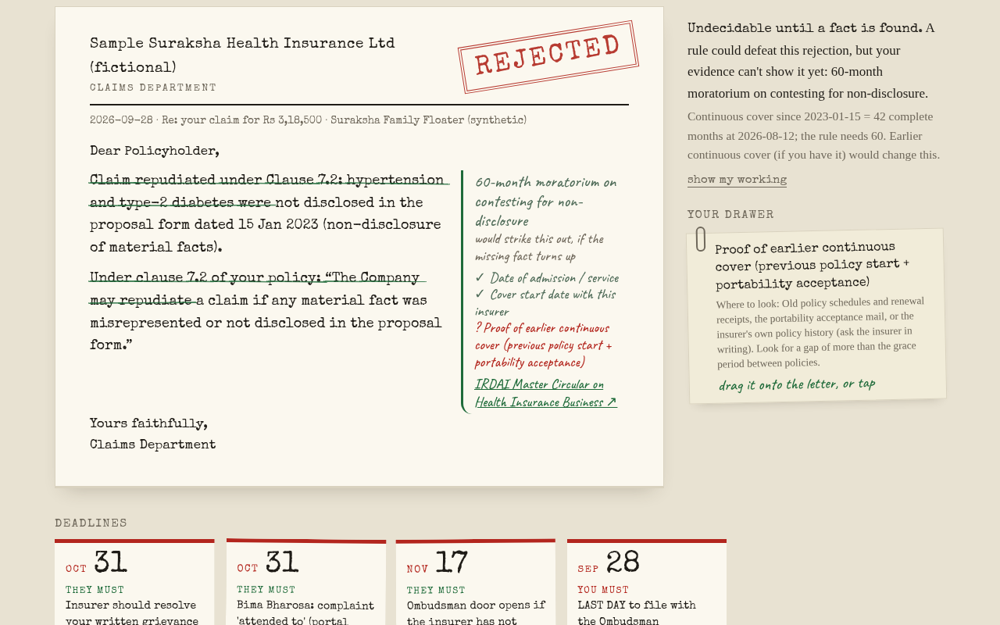
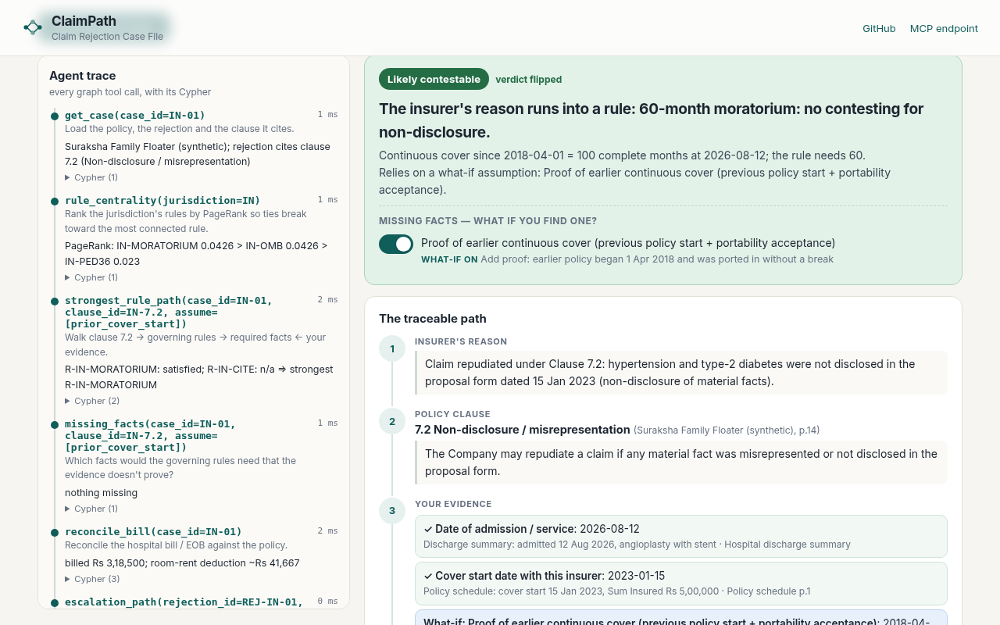

# ClaimPath - the Claim Rejection Case File

**Live:** https://claimpath-srini5.vercel.app &nbsp;|&nbsp; **Track 1:** Agents That Act on Connected Data (FalkorDB Graph Hacks) &nbsp;|&nbsp; **MCP:** `POST https://claimpath-srini5.vercel.app/mcp`




## Why

A rejection letter is written to end the conversation. It is short, confident, and cites one clause. Most people read it, feel it is final, and stop. In the US, KFF found that fewer than 1% of denied in-network marketplace claims were appealed in 2023. In India, the Insurance Ombudsman received 31,490 health complaints in FY2023-24, almost all about rejected claims (both figures are secondary reports; see Limitations).

The frustrating part: the rules are often on the policyholder's side. India's regulator says that after 60 months of continuous cover a claim cannot be contested for non-disclosure. US federal rules say emergency services cannot require prior authorization. But those rules are scattered across circulars and CFR sections nobody reads, and the insurer's letter never mentions them.

## What

ClaimPath takes one rejection and shows **one traceable path**, with a source link at every step:

> insurer's reason -> the policy clause it relies on -> what **your** evidence proves (dates, bill lines) -> the governing rule -> verdict

The verdict is one of **likely contestable**, **likely valid**, or **undecidable until X is found**, with the list of missing facts and where to look. A **what-if toggle** adds a missing fact and the verdict flips live. It then reconciles the hospital bill against the policy (India: room-rent proportionate deduction; US: denied EOB lines), starts the deadline clock, and drafts the appeal / grievance letter for you to send yourself.

ClaimPath never files anything and never contacts anyone. Sample cases are **synthetic** (one India, one USA); a separate panel shows 118 **real past decisions** (see below). The rules are real and each carries the URL of the official text. **Not legal or medical advice.**

## How (and why the graph is the product)

If you take FalkorDB out, there is nothing left: every tool is a Cypher query, and the verdict is computed from the traversal results. The hosted/local database is the only store.

```
(Case)-[:HAS_POLICY]->(Policy)-[:HAS_CLAUSE]->(Clause)
(Case)-[:HAS_REJECTION]->(Rejection)-[:CITES]->(Clause)
(Clause)-[:LIMITED_BY {why}]->(Rule {source_url, citation, verification, effect, kind, threshold})
(Rule)-[:REQUIRES {role: core|extends}]->(FactType {key, label, how_to_find})
(Evidence {case_id, kind, date, amount})-[:PROVES {value}]->(FactType)
(Case)-[:HAS_EVIDENCE]->(Evidence)         // documents, adverse evidence, hospital bill lines
(Rejection)-[:APPEAL_VIA]->(Rule)          // first remedy
(Rule)-[:RELATES {kind: supports|escalates}]->(Rule)
(Rule)-[:HAS_DEADLINE]->(Deadline {amount, unit, anchor, kind})
(Precedent {outcome, year, forum, source_url, ...})-[:ANALOGOUS_TO]->(Clause)   // REAL past decisions, context only
(Precedent)-[:BEARS_ON]->(Rule)                                              // via the clause's LIMITED_BY rule
```

**Multi-hop traversal** (`strongest_rule_path`): Clause -> Rule -> FactType <- Evidence in one query; the rule is evaluated in code from those facts (date math is code, not a model).

```cypher
MATCH (cl:Clause {id:$clid})
OPTIONAL MATCH (cl)-[lb:LIMITED_BY]->(r:Rule)
OPTIONAL MATCH (r)-[rq:REQUIRES]->(ft:FactType)
OPTIONAL MATCH (ev:Evidence {case_id:$cid})-[pv:PROVES]->(ft)
RETURN r.id, r.name, r.citation, ..., ft.key, rq.role, ev.id, pv.value
```

**Graph algorithms as tools:** `rule_centrality` runs `CALL algo.pageRank('Rule','RELATES')` inside FalkorDB to break ties between rules; `escalation_path` uses `shortestPath((rejection)-[:APPEAL_VIA|RELATES*..6]->(terminal:Rule))` to find the route to the final free forum (Ombudsman / external review).

**What-if is a query parameter, not a write:** `assume=["prior_cover_start"]` marks a missing FactType as provided for one request. Nothing is persisted, so visitors never affect each other.

### Agent tools (UI trace panel and `/mcp` use the same registry)

| Tool | What it does | Graph feature |
|---|---|---|
| `get_case` | Policy, rejection reason, cited clause | pattern match |
| `match_reason` | Pasted rejection text -> best clause | clause keyword nodes |
| `rule_centrality` | Ranks the jurisdiction's rules | **PageRank** |
| `strongest_rule_path` | Clause -> Rule -> required facts <- evidence, evaluated | **multi-hop traversal** |
| `missing_facts` | Facts the rules need that evidence doesn't prove | OPTIONAL MATCH anti-join |
| `reconcile_bill` | Bill vs policy: room-rent proportionate deduction (IN) / denied lines (US) | aggregation |
| `escalation_path` | Rejection -> final free forum | **shortestPath** |
| `deadline_clock` | Deadlines the remedy rules start | variable-length traversal |
| `precedent_lookup` | REAL past decisions analogous to the cited clause, plus ones on other clauses under the same rule (context only, never changes the verdict) | **2-hop traversal** Clause -> Rule <- Clause <- Precedent |
| `rule_catalog` | Rules with source URL + verification note | scan |

The agent is rule-based (no LLM key). It plans tool calls from the case, logs **every** call with its Cypher, parameters, row count and timing, and renders them in the trace panel. The `/mcp` endpoint (JSON-RPC over HTTP: `initialize`, `tools/list`, `tools/call`) lets any MCP client pick the same tools:

```bash
curl -s -X POST https://claimpath-srini5.vercel.app/mcp -H 'content-type: application/json' \
  -d '{"jsonrpc":"2.0","id":1,"method":"tools/call","params":{"name":"missing_facts","arguments":{"case_id":"IN-01","clause_id":"IN-7.2"}}}'
```

## Run locally (under 5 minutes)

```bash
git clone https://github.com/sivaratrisrinivas/claimpath && cd claimpath
./scripts/run_local.sh        # starts falkordb/falkordb in Docker, seeds the graph, serves http://localhost:8000
# tests (real FalkorDB via falkordblite, no Docker needed):
python3 -m venv .venv && .venv/bin/pip install -r requirements-dev.txt && .venv/bin/python -m pytest -q
```

Hosted: set `FALKORDB_HOST`, `FALKORDB_PORT`, `FALKORDB_USERNAME`, `FALKORDB_PASSWORD` (and `FALKORDB_SSL=1` if TLS). On cold start the graph is seeded idempotently with batched `UNWIND` writes, guarded by a lock *graph* (a hosted FalkorDB user may not be allowed raw `SET`), and one connection is reused across requests. The deployed instance is FalkorDB Cloud.

## Real past decisions (Precedent nodes)

Beyond the two synthetic cases, the graph holds **118 real, public, past decisions** shown in a "Similar real past cases" panel after the agent runs. They are context only: the verdict is still driven by the synthetic cases and the real rules. Counts loaded (exactly what `backend/precedents.json` contains):

| Source | Loaded | Years | What each record has |
|---|---|---|---|
| Insurance Ombudsman award summaries, Council for Insurance Ombudsmen compilations on cioins.co.in (Mediclaim-Book12/13/14/16/17 PDFs) | **58** (of 111 that passed filters; ~700 entries parsed from the books) | 2009-2012 | case no., centre (when printed), year, claim type, first Rs amount, policy clause number as quoted, reason, outcome, excerpt, source URL |
| California DMHC Independent Medical Review determinations (CHHS open data CSV, 42,749 rows in total; 5,991 rows from 2024-2026 passed filters) | **60** (8+8 on imaging/emergency/urgent-type treatments, 22+22 other medical necessity; half overturned, half upheld) | 2024-2026 | reference id, year, diagnosis/treatment category, determination, Findings excerpt, source URL |

Each precedent is linked to the nearest sample Clause (keyword match) and, through it, to the Rule that limits that clause. `scripts/build_precedents.py` regenerates the JSON from the downloaded sources; selection is seeded and deterministic.

**Caveats (also shown in the app):**
- **India awards pre-date current rules.** They are 2009-2012, before the Ombudsman Rules 2017 and the IRDAI 2024 Master Circular (60-month moratorium, 36-month PED cap). The CIO no longer publishes awards publicly (parties download with an OTP), so no newer set exists. They show how disputes were argued, not how they would be decided today.
- **Not a success rate.** The sample is keyword-selected and balanced by outcome (India's non-disclosure set is only 2 claimant-favoured of 16 because the books contain few). Never read the counts as win rates.
- **Approximate links.** Clause mapping is automatic keyword matching. India text was OCR'd from PDFs and can contain errors. Complainant/patient names are removed (a test checks for honorifics + names; it is a heuristic, not a guarantee).
- **California IMRs** cover state-regulated plans only, contain no policy clause, dates or amounts, and decide medical necessity (a different question from a prior-authorization technicality). The US-01 sample's "imaging/emergency" group is matched by treatment keywords, so it is the nearest available, not an exact analogue.
- **Licences/terms.** CIO PDFs: no licence statement found; public official documents, abbreviated with attribution. DMHC data: one portal page lists Creative Commons Attribution, another "CHHS Terms of Use"; attribution is given. I did not use CourtListener, Indian Kanoon or any scraping; the two sources are direct file downloads. Check terms before any larger redistribution.

## Honest limitations

- **Two synthetic sample cases.** The insurers, people, policies and bills are invented. The rules are real; the facts are not.
- **A small rules graph (10 rules).** "Likely valid" means *no rule in this graph defeats the clause*, not that the insurer is right. It is a triage aid, not a prediction of outcome; the real past decisions are an illustrative, non-representative sample, so there is still no win-rate data.
- **Verification varies per rule** and each rule node states it. The IRDAI 60-month moratorium and rejection-letter rules were read from the IRDAI Master Circular text (29 May 2024); the 36-month PED cap is confirmed only through secondary reporting; US rules were read on eCFR. Paragraph numbering follows the circular's own table. Applicability to older policies was not checked.
- **India Ombudsman deadline is conservative:** Rule 14(3) counts one year from the insurer's reply to your representation; ClaimPath shows one year from the claim rejection (the Council of Insurance Ombudsmen's guidance) so you are never late.
- **US:** plan type matters (self-funded ERISA vs fully insured, state vs federal external review). ClaimPath encodes the federal floor only. The "emergency" question is ultimately a fact decision by the plan or reviewer.
- **Pasted text** is matched to a clause by keyword overlap, not by a language model.
- No OCR / document upload, no tracking of real claims, no state insurance-department rules, no Indian consumer-court limitation (not encoded).
- Competitors exist (ClaimRights, ClaimBhai, Counterforce Health, Fight Health Insurance, and others). The wedge here is the auditable path with a source at every hop plus bill-vs-policy reconciliation; we did not benchmark against them.
- Secondary figures in "Why" (KFF <1%; 31,490 Ombudsman complaints) come from press/summary reports, not from the primary PDFs.

## AI assistance disclosure

Built with AI coding assistance (Grok Bot). The author is responsible for the code and can explain the graph model, queries and architecture above. The project is new work for this hackathon; it reuses only generic infrastructure patterns (FastAPI, a single reused DB connection, lock-graph seeding).

## Sources (all linked on the rule nodes)

- IRDAI Master Circular on Health Insurance Business, 29 May 2024 (items 13, 17): https://irdai.gov.in/ (PDF linked in `backend/data.py`); text copy: https://taxguru.in/corporate-law/master-circular-irdai-insurance-productsregulations-2024health-insurance.html
- IRDAI policyholder portal, how to complain: https://policyholder.gov.in/how-to-make-a-complaint
- IRDAI Bima Bharosa: https://bimabharosa.irdai.gov.in/
- Insurance Ombudsman Rules, 2017 (rule 14): indiacode.nic.in (linked in `backend/data.py`); procedure: https://www.cioins.co.in/Procedure/Index
- 45 CFR 149.110 (emergency services, no prior authorization): https://www.ecfr.gov/current/title-45/subtitle-A/subchapter-B/part-149/subpart-B/section-149.110
- 29 CFR 2560.503-1 (ERISA claims procedure): https://www.ecfr.gov/current/title-29/subtitle-B/chapter-XXV/subchapter-F/part-2560/section-2560.503-1
- 45 CFR 147.136 (internal appeals and external review): https://www.ecfr.gov/current/title-45/subtitle-A/subchapter-B/part-147/section-147.136 ; CMS external review: https://www.cms.gov/cciio/programs-and-initiatives/consumer-support-and-information/csg-ext-appeals-facts
- CNBC-TV18 on the 36-month PED cap (secondary): https://www.cnbctv18.com/personal-finance/insurance-irdai-reduces-waiting-period-moratorium-lower-how-will-health-policies-benefit-19396754.htm
